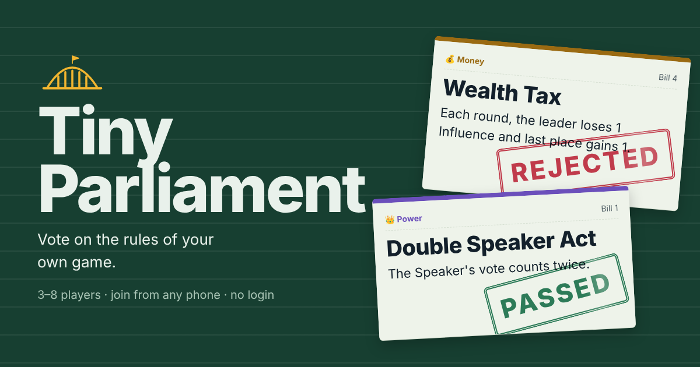

# Tiny Parliament

**A party game where you vote on the rules of your own game.**



Friends join a room from any phone or laptop with a 4-letter code. No login, no install. Everyone becomes a minister of a tiny, absurd country. Each round the Speaker puts a bill to a vote, and every law that passes rewrites the rules for everyone, instantly, on every screen. A secret agenda per player flips the final score when it is revealed at the end.

3–8 players · about 15 minutes · works in the same room or on a video call · bots fill empty seats.

## How to play

1. **Propose.** Each round a different Speaker privately sees two bills and picks one.
2. **Debate.** Argue out loud for up to 45 seconds. Voting opens when everyone taps ready.
3. **Vote.** Aye or Nay, all at once. Majority passes, ties fail, no vote counts as Nay.
4. **Live with it.** A passed law joins the Constitution (max 5; a sixth repeals the oldest) and changes the rules immediately.

**Scoring:** +2 when your proposal passes, +1 each time you vote with the result. After round 8, secret agendas are revealed for a +3 or +4 bonus. Most Influence becomes Prime Minister.

### The 12 laws

| Law | Tag | Effect |
| --- | --- | --- |
| Double Speaker Act | Power | The Speaker's vote counts twice |
| Secret Ballot | Power | Only vote totals are shown (repeals Free Press) |
| Supermajority Act | Power | Laws need two thirds to pass |
| Wealth Tax | Money | Each round the leader loses 1, last place gains 1 |
| Lobbying Act | Money | Pay 1 Influence for +1 vote, once per round |
| Stimulus Package | Money | Everyone +1 now and whenever another Money law passes |
| Free Press Act | Speech | Votes are public live as they are cast (repeals Secret Ballot) |
| Gag Order | Speech | The Speaker can't vote on their own bill |
| Right to Repeal | Speech | The Speaker may propose repealing an active law |
| Speed Session | Chaos | Voting time drops to 10 seconds |
| Contrarian Act | Chaos | A unanimous vote fails and costs everyone 1 |
| Agenda Shuffle | Chaos | Decree: every secret agenda moves one seat left |

## How it works

Tiny Parliament is a static site with no backend.

- **The host's browser is the game server.** It holds the only copy of the game state, runs every timer, and sends each player a view with secrets removed (other players' agendas, the Speaker's unchosen bill, individual votes under Secret Ballot).
- **Players connect peer-to-peer** over WebRTC data channels using [PeerJS](https://peerjs.com). The room code maps to the host's peer id; PeerJS's free public broker only introduces the devices.
- **Laws are data plus rule hooks** (`voteWeight`, `passThreshold`, `voteSeconds`, `onEnact`, `onRoundEnd`…) in `js/laws.js`. The engine asks the active laws for answers, so adding a law never touches the game loop.
- **Reconnects:** each tab keeps its seat token in `sessionStorage`. A player who refreshes or loses signal rejoins the same seat with the same agenda. If the host refreshes, the room reopens under the same code and everyone reconnects; the game pauses if fewer than 3 ministers are present.
- **Edge cases handled:** late joiners watch from the gallery, an absent Speaker gets an automatic proposal after 15 seconds, duplicate names and wrong codes get clear messages, and the host can remove players or add bots in the lobby.

```
index.html        page shell
css/style.css     all styles
js/laws.js        law deck, secret agendas, ministry names
js/engine.js      game rules and state (pure, no DOM or network)
js/bots.js        bot ministers that follow their agendas
js/net.js         PeerJS host/client networking with heartbeats and retries
js/app.js         screens, host loop, client connection
tests/            engine unit tests and a 3-tab end-to-end playthrough
```

## Run locally

Any static server works:

```bash
npx serve .            # or: python3 -m http.server 5173
```

Open the page, create a room, then open the invite link in a second tab or on your phone (same Wi-Fi, or deploy first). Add bots from the lobby to try it alone.

## Tests

```bash
npm test               # 14 engine tests: every law, agendas, scoring, reconnects, a full bot game
```

The end-to-end test plays a full game across three browser tabs with a stand-in for PeerJS (`tests/fake-peer.js`), so it runs offline:

```bash
npm i -D playwright && npx playwright install chromium
python3 -m http.server 5173 &
node tests/e2e.mjs
```

## Deploy to Netlify

1. In Netlify, choose **Add new site → Import an existing project** and pick this repository.
2. Leave the build command empty and set the publish directory to `.` (already set in `netlify.toml`).
3. Deploy. Share the site URL; players enter the room code shown in the lobby.

## Notes

- The host keeps their tab open; the game runs on their device.
- Very restrictive networks (some corporate or campus Wi-Fi) can block peer-to-peer connections. Switching one device to mobile data usually fixes it.
